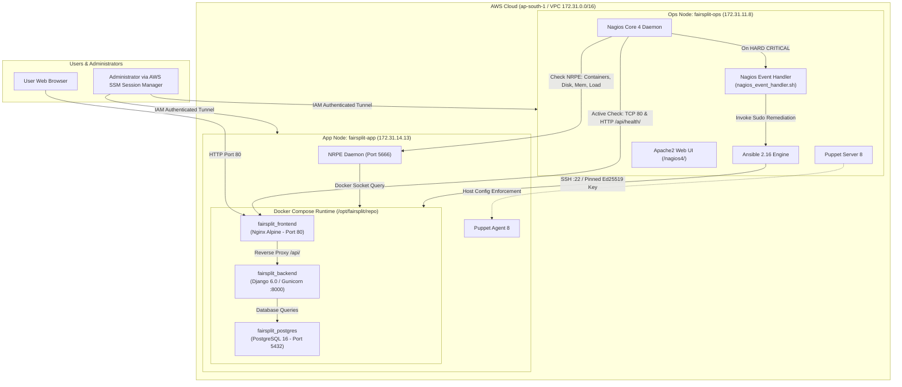
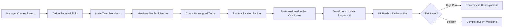
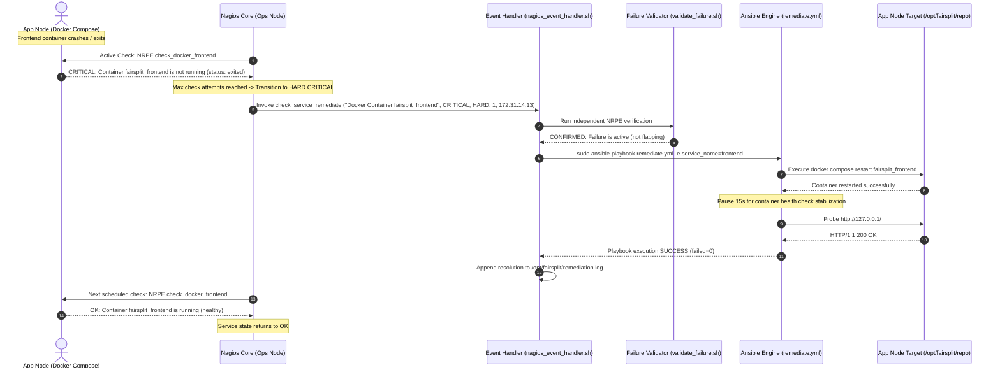

# ⚖️ FairSplit: Intelligent Project Workload Balancing & Self-Healing DevOps Architecture

> **An enterprise-grade, full-stack project management platform with heuristic workload balancing, machine learning risk prediction, and a resilient AWS infrastructure featuring automated self-healing via Nagios Core and Ansible.**

[](https://github.com/PrakharPurwar12/FairSplit)
[](LICENSE)
[](https://react.dev/)
[](https://www.djangoproject.com/)
[](https://www.postgresql.org/)
[](https://www.docker.com/)
[](https://www.terraform.io/)
[](https://puppet.com/)
[](https://www.ansible.com/)
[](https://www.nagios.org/)

---

## 📌 Table of Contents

1. [Project Title and Overview](#1-project-title-and-overview)
2. [Problem Statement](#2-problem-statement)
3. [Key Features](#3-key-features)
4. [System Architecture](#4-system-architecture)
5. [Architecture Diagram (Mermaid)](#5-architecture-diagram-mermaid)
6. [Technology Stack](#6-technology-stack)
7. [Project Directory Structure](#7-project-directory-structure)
8. [Application Workflow](#8-application-workflow)
9. [AI/Intelligent Workload Allocation and Risk Prediction](#9-aiintelligent-workload-allocation-and-risk-prediction)
10. [Frontend Overview](#10-frontend-overview)
11. [Backend and REST API Overview](#11-backend-and-rest-api-overview)
12. [Database Design and PostgreSQL Integration](#12-database-design-and-postgresql-integration)
13. [Docker and Containerization](#13-docker-and-containerization)
14. [AWS Infrastructure](#14-aws-infrastructure)
15. [Puppet Configuration Management](#15-puppet-configuration-management)
16. [Ansible Deployment and Remediation](#16-ansible-deployment-and-remediation)
17. [Nagios Core Monitoring](#17-nagios-core-monitoring)
18. [Automated Self-Healing Workflow](#18-automated-self-healing-workflow)
19. [Security Considerations](#19-security-considerations)
20. [Prerequisites](#20-prerequisites)
21. [Local Installation and Setup](#21-local-installation-and-setup)
22. [Environment Variables](#22-environment-variables)
23. [Running the Application](#23-running-the-application)
24. [Deployment Overview](#24-deployment-overview)
25. [Validation and Testing](#25-validation-and-testing)
26. [Troubleshooting](#26-troubleshooting)
27. [Future Improvements](#27-future-improvements)
28. [Author / Project Links](#28-author--project-links)

---

## 1. Project Title and Overview

**FairSplit** is an intelligent full-stack project management and operations platform engineered to address two critical challenges in modern software engineering:
1. **Application Layer:** Preventing developer burnout, skill mismatch, and task delivery bottlenecks through algorithmic task distribution and machine learning delivery risk prediction.
2. **Operations Layer:** Maintaining continuous service availability across cloud infrastructure through declarative configuration management, active health monitoring, and closed-loop automated self-healing.

FairSplit integrates a modern React SPA and Django REST Framework backend with production-grade Site Reliability Engineering (SRE) patterns. Deployed across AWS EC2 instances managed via Terraform, Puppet 8, Ansible, and Nagios Core 4, FairSplit automatically detects runtime failures and executes zero-touch automated remediation playbooks to restore services without manual intervention.

---

## 2. Problem Statement

In fast-paced engineering teams, project delivery frequently fails due to systemic imbalances:
- **Unequal Workload Distribution:** High-performing developers are overloaded while others remain underutilized, causing fatigue, missed sprint deadlines, and turnover.
- **Skill-to-Task Misalignment:** Tasks assigned without considering verified developer competencies lead to poor implementation velocity and elevated defect rates.
- **Latent Delivery Bottlenecks:** Project managers often discover schedule slippage only at the end of a sprint, long after intervention could have prevented delivery delays.
- **Fragile Infrastructure Operations:** Traditional cloud deployments rely on manual incident triage when containerized web services fail, leading to prolonged Mean Time to Resolution (MTTR) and avoidable downtime.

FairSplit solves these challenges by combining mathematical fairness algorithms and Scikit-Learn risk inference at the application layer with automated monitoring and self-healing at the infrastructure layer.

---

## 3. Key Features

### 🔹 Application Features
- **Kanban Task Management Board:** Interactive task lifecycle tracking across `Todo`, `In Progress`, `In Review`, and `Completed` statuses.
- **Multi-Factor Task Scoring:** Granular task auditing with difficulty scales (1–5), priorities (`low`, `medium`, `high`, `critical`), and estimated vs. actual hours.
- **Deterministic Workload Balancing:** Multi-criteria heuristic assignment engine factoring skill match, available bandwidth, and fairness penalties.
- **Machine Learning Delivery Risk Prediction:** Supervised Random Forest model that evaluates task completion velocity, deadline proximity, and assignee load on every progress update.
- **Smart Reassignment Recommendations:** Recommends optimal alternate assignees with human-readable rationale when bottlenecks occur.
- **Role-Based Access Control (RBAC):** Strict JWT-authenticated permissions distinguishing project `manager` capabilities from `member` views.
- **Project Analytics Dashboard:** Visual summaries of workload distributions, milestone progress, and risk breakdown charts.

### 🔹 DevOps & SRE Features
- **Infrastructure as Code (IaC):** Modular Terraform configurations managing VPC networking, subnets, EC2 instances, and security groups.
- **Configuration Management:** Puppet 8 Server-Agent architecture enforcing baseline packages, users, security baselines, and swap space.
- **Automated Deployment & Orchestration:** Ansible playbooks automating application setup, Docker Compose deployment, backups, and restores.
- **Continuous Monitoring:** Nagios Core 4 checking host reachability, HTTP availability, Django REST API health, and database connectivity.
- **Secure Remote Metrics (NRPE):** Hardened Nagios Remote Plugin Executor monitoring container health, memory, disk, and load on managed instances.
- **Automated Self-Healing:** Event-driven remediation bridging Nagios HARD CRITICAL state alerts directly to targeted Ansible playbooks.
- **Zero Public SSH Exposure:** Remote instance access managed entirely through AWS Systems Manager (SSM) Session Manager.

---

## 4. System Architecture

FairSplit divides responsibilities between two dedicated compute nodes in AWS:

```
                                      AWS VPC (172.31.0.0/16)
 ┌──────────────────────────────────────────────────────────────────────────────────────────────┐
 │                                                                                              │
 │   ┌─────────────────────────────────────────┐      ┌──────────────────────────────────────┐  │
 │   │         Ops Node (fairsplit-ops)        │      │       App Node (fairsplit-app)       │  │
 │   │               172.31.11.8               │      │             172.31.14.13             │  │
 │   ├─────────────────────────────────────────┤      ├──────────────────────────────────────┤  │
 │   │ • Puppet Server 8                       │      │ • Puppet Agent 8                     │  │
 │   │ • Ansible Control Node                  │      │ • Nagios NRPE Daemon (Port 5666)     │  │
 │   │ • Nagios Core 4 Monitoring              │      │ • Docker Compose Orchestrator        │  │
 │   │ • Apache2 Web UI (Port 80 /nagios4/)    │      │   ├─ fairsplit_frontend (Nginx :80)  │  │
 │   │ • Nagios Event Handler                  │      │   ├─ fairsplit_backend (Gunicorn)    │  │
 │   │ • SSH Key (Ed25519) to App Node         │      │   └─ fairsplit_postgres (Internal)   │  │
 │   │ • AWS SSM Agent                         │      │ • AWS SSM Agent                      │  │
 │   └─────────────────────────────────────────┘      └──────────────────────────────────────┘  │
 │                        │                                              ▲                      │
 │                        │           Active Monitoring (HTTP / TCP)     │                      │
 │                        ├──────────────────────────────────────────────┤                      │
 │                        │           NRPE Metric Checks (Port 5666)     │                      │
 │                        ├──────────────────────────────────────────────┤                      │
 │                        │           Ansible Remediation (SSH :22)      │                      │
 │                        └──────────────────────────────────────────────┘                      │
 │                                                                                              │
 └──────────────────────────────────────────────────────────────────────────────────────────────┘
```

- **Ops Node (`fairsplit-ops` / `172.31.11.8`):** Acts as the centralized management plane. Hosts the Puppet Server, Ansible control environment, Nagios Core daemon, and event handlers.
- **App Node (`fairsplit-app` / `172.31.14.13`):** Hosts the production Docker Compose workload (Nginx frontend, Django backend, PostgreSQL database), Puppet Agent, and hardened NRPE daemon.
- **Network Boundaries:** Ops communicates with App over the internal AWS VPC CIDR (`172.31.0.0/16`). App services (PostgreSQL, Django port 8000) are isolated from public ingress.

---

## 5. Architecture Diagram (Mermaid)

The following diagram illustrates the deployment topology, network boundaries, and monitoring/remediation channels:



---

## 6. Technology Stack

| Domain | Technology | Version | Purpose in FairSplit |
|---|---|---|---|
| **Frontend** | React | `19.0.0` | Declarative UI for Kanban board, project analytics, and task allocation |
| **Build Tool** | Vite | `8.x` | High-speed frontend bundling and Hot Module Replacement (HMR) |
| **Routing** | React Router | `7.x` | Client-side routing with JWT-protected route guards |
| **Styling** | Tailwind CSS / CSS | Modern | Responsive dashboards, theme variables, and modular component styling |
| **Backend** | Django | `6.0.7` | High-level Python web framework providing ORM, routing, and security |
| **API Framework**| Django REST Framework | `3.15` | Serializers, viewsets, and RESTful API endpoints |
| **WSGI Server** | Gunicorn | `23.x` | Production WSGI HTTP server running 3 workers and 2 threads |
| **Database** | PostgreSQL | `16-alpine` | Relational database for accounts, projects, tasks, skills, and logs |
| **Machine Learning** | Scikit-Learn | `1.4.x` | Random Forest Classifier for delivery risk inference |
| **Model Storage**| Joblib | `1.4.x` | Serialized model assets (`risk_model.pkl`, label encoders) |
| **Containers** | Docker & Compose | `24.x+` | Multi-container runtime packaging frontend, backend, and database |
| **Reverse Proxy**| Nginx | `1.31-alpine`| Serves static SPA build and reverse proxies `/api/` requests |
| **IaC** | Terraform | `1.14` | Provisions VPC, subnets, EC2 instances, and security groups |
| **Config Mgmt** | Puppet | `8.x` | Enforces OS packages, security baselines, and swap allocation |
| **Automation** | Ansible | `2.16` | Executes application deployments and self-healing playbooks |
| **Monitoring** | Nagios Core | `4.4.6` | Active polling, status reporting, alerting, and event handler triggers |
| **Agent Check** | Nagios NRPE | `4.x` | Secure remote metric collector for container and resource checks |
| **Cloud Provider**| AWS | `ap-south-1` | Cloud infrastructure hosting Ops and App compute nodes |
| **Access Control**| AWS Systems Manager | SSM Agent | Encrypted terminal access eliminating public SSH exposure |

---

## 7. Project Directory Structure

```text
FairSplit/
├── .github/
│   └── workflows/                          # GitHub Actions CI/CD workflows
│       ├── ci.yml                          # Tests, builds, and container linting
│       ├── lint.yml                        # Black, isort, Flake8, ESLint enforcement
│       └── security.yml                    # pip-audit, npm audit, Trivy security scan
├── ansible/                                # Ansible automation engine
│   ├── ansible.cfg                         # Configuration (strict host key checking)
│   ├── group_vars/                         # Environment variables (all.yml, app.yml)
│   ├── inventory/
│   │   └── hosts.ini                       # Inventory mapping fairsplit-ops and fairsplit-app
│   ├── playbooks/                          # Operational playbooks
│   │   ├── deploy.yml                      # Full application deployment
│   │   ├── remediate.yml                   # Automated container self-healing playbook
│   │   ├── backup.yml                      # PostgreSQL backup automation
│   │   ├── restore.yml                     # PostgreSQL snapshot restoration
│   │   └── rollback.yml                    # Release rollback automation
│   └── roles/                              # Ansible modular roles
├── backend/                                # Django REST Framework project
│   ├── account/                            # User authentication and profile management
│   ├── allocation/                         # Heuristic workload allocation engine
│   ├── analytics/                          # Workload and risk visualization endpoints
│   ├── backend/                            # Core Django settings, URLs, and WSGI
│   ├── ml/                                 # ML risk inference engine and training scripts
│   │   ├── models/                         # Serialized models (.pkl) and encoders
│   │   ├── predictor.py                    # Inference pipeline and feature extraction
│   │   └── train.py                        # Training pipeline for Random Forest model
│   ├── notifications/                      # User in-app notification services
│   ├── project/                            # Project workspaces and team members
│   ├── skills/                             # Skills catalogue and user proficiency scores
│   ├── tasks/                              # Task lifecycle, priorities, and assignments
│   ├── Dockerfile                          # Backend container build specification
│   ├── manage.py                           # Django CLI entrypoint
│   └── requirements.txt                    # Python dependencies
├── docs/                                   # Verified architecture and operational runbooks
│   ├── architecture/ARCHITECTURE.md        # Complete system architecture specification
│   ├── deployment/DEPLOYMENT.md            # Comprehensive AWS deployment guide
│   ├── evidence/IMPLEMENTATION_SUMMARY.md  # Implementation audit and verification logs
│   ├── monitoring/                         # Nagios Core & Ansible remediation manual
│   └── testing/TESTING_RUNBOOK.md          # End-to-end testing and self-healing runbook
├── frontend/                               # React 19 Single Page Application
│   ├── src/
│   │   ├── components/                     # Reusable UI widgets and navigation
│   │   ├── context/                        # React Authentication Context Provider
│   │   ├── pages/                          # Views (Dashboard, Kanban, Analytics, AI)
│   │   └── services/                       # Axios API communication client
│   ├── Dockerfile                          # Multi-stage frontend container build
│   ├── nginx.conf                          # Nginx proxy configuration
│   └── package.json                        # Dependencies and build scripts
├── nagios/                                 # Nagios Core monitoring configuration
│   ├── objects/
│   │   ├── commands.cfg                    # Active check and event handler definitions
│   │   ├── hosts.cfg                       # Monitored host declarations (fairsplit-app)
│   │   └── services.cfg                    # 10 monitored services and thresholds
│   └── plugins/                            # Custom monitoring plugin scripts
│       ├── check_disk.sh                   # Filesystem threshold monitor
│       ├── check_docker_container.sh       # Docker container status checker
│       ├── check_fairsplit.sh              # Web application health probe
│       ├── check_fairsplit_api.sh          # JSON API parsing health check
│       ├── check_fairsplit_db.sh           # Database health probe via API
│       └── check_mem.sh                    # Linux memory utilization monitor
├── puppet/                                 # Puppet 8 infrastructure configuration
│   ├── manifests/site.pp                   # Node classification (ops and app roles)
│   ├── hiera.yaml                          # Hiera 5 hierarchy configuration
│   └── modules/                            # Modules: common, security, docker, nrpe, nagios
├── remediation/                            # Self-healing event-driven bridge
│   ├── event_handlers/
│   │   └── nagios_event_handler.sh         # Nagios alert handler invoking Ansible
│   ├── scripts/
│   │   ├── validate_failure.sh             # Independent failure verification script
│   │   └── recovery_log.sh                 # Incident logging utility
│   └── sudoers/                            # Sudo privilege boundaries for nagios user
├── scripts/                                # Bootstrap and automated validation suites
│   ├── bootstrap/
│   │   ├── bootstrap_ops.sh                # Idempotent Ops node setup script
│   │   └── bootstrap_app.sh                # Idempotent App node setup script
│   ├── security/
│   │   └── verify_and_pin_ssh_host_key.sh  # Cryptographic SSH host key pinning script
│   └── validation/                         # Automated test harnesses
│       ├── validate_infrastructure.sh      # AWS EC2, SSM, and network validation
│       ├── validate_puppet.sh              # Puppet compilation and catalog validation
│       ├── validate_ansible.sh             # Ansible syntax, roles, and ping checks
│       └── validate_nagios.sh              # Nagios syntax, plugins, and daemon tests
├── terraform/                              # Terraform AWS infrastructure modules
│   ├── main.tf                             # Root Terraform configuration
│   ├── variables.tf                        # Infrastructure input variables
│   ├── outputs.tf                          # Output parameters (IPs, VPC, IDs)
│   └── modules/                            # Modules: network, compute, security
├── docker-compose.yml                      # Production Docker Compose specification
└── README.md                               # Project documentation
```

---

## 8. Application Workflow

The FairSplit platform operates across a cohesive user lifecycle:



1. **Project Inception:** A project manager creates a project workspace, defining required domain skills (e.g., `Django`, `React`, `PostgreSQL`, `Docker`).
2. **Team Onboarding:** Members join via email invitation and configure verified numeric proficiency levels (1–5) for each skill.
3. **Task Definition:** Tasks are created with estimated hours, target delivery dates, difficulty scores (1–5), and required skills.
4. **Algorithmic Allocation:** The project manager triggers the allocation engine. Unassigned tasks are distributed to team members based on skill match, available capacity, and fairness penalties.
5. **Execution & Auditing:** Developers update task progress percentages on the Kanban board.
6. **Continuous Risk Inference:** Each progress update triggers the Random Forest ML pipeline, analyzing velocity against deadlines to detect bottlenecks before delays impact the project.

---

## 9. AI/Intelligent Workload Allocation and Risk Prediction

FairSplit clearly distinguishes between **deterministic heuristic task allocation** and **probabilistic machine learning delivery risk prediction**.

### 1. Deterministic Heuristic Workload Allocation (`backend/allocation/algorithms.py`)
FairSplit uses a multi-factor mathematical scoring model to allocate unassigned tasks. It does not use opaque deep learning for allocation; instead, it uses a deterministic, explainable heuristic:

$$\text{Final Score} = (0.7 \times \text{Skill Score}) + (0.3 \times \text{Workload Score}) - \text{Fairness Penalty}$$

- **Skill Score:** Measures the match between required task skills and user proficiencies:
  $$\text{Skill Score} = \sum (\text{User Skill Proficiency} \times \text{Requirement Importance})$$
- **Workload Score:** Evaluates remaining bandwidth based on a standard 40-hour weekly capacity limit:
  $$\text{Utilization} = \frac{\text{Current Assigned Hours}}{40}$$
  $$\text{Workload Score} = \max(0, (1 - \text{Utilization}) \times 100)$$
- **Fairness Penalty:** Prevents task hoarding by deducting points based on active task count:
  $$\text{Fairness Penalty} = \text{Active Task Count} \times 5$$
- **Confidence Rating:** Calculated based on the separation between the top candidate and the runner-up:
  $$\text{Confidence} = \frac{\text{Best Score} - \text{Second Best Score}}{\text{Best Score}} \times 100$$

### 2. Machine Learning Delivery Risk Prediction (`backend/ml/predictor.py`)
To forecast whether an in-flight task will slip past its deadline, FairSplit employs a supervised **Random Forest Classifier** (`backend/ml/models/risk_model.pkl`).

- **Input Features (9 Dimensions):**
  1. `estimated_hours` (numeric hours)
  2. `difficulty` (1–5 scale)
  3. `priority` (label encoded: `low`, `medium`, `high`, `critical`)
  4. `required_skills` (count of required skills)
  5. `skill_score` (calculated proficiency match)
  6. `workload_score` (current assignee capacity score)
  7. `active_tasks` (current assignee active task count)
  8. `days_left` (days remaining until due date)
  9. `completion_percentage` (reported progress 0–100%)
- **Model Output:**
  - `predicted_risk`: Classification category (`low`, `medium`, `high`).
  - `confidence`: Highest class probability percentage.
  - `probabilities`: Probability distribution across all three risk classes.
- **Inference Trigger:** The model is evaluated automatically whenever a user calls `PATCH /api/tasks/{id}/progress/`. If high risk is detected, a smart reassignment candidate is calculated.

---

## 10. Frontend Overview

The FairSplit frontend is built with **React 19** and **Vite 8**, providing an intuitive Single Page Application (SPA) experience:
- **State & Authentication:** Centralized `AuthContext` manages SimpleJWT tokens (`access` and `refresh`), user identities, and auto-logout flows.
- **API Communication Layer:** Standardized Axios HTTP client (`frontend/src/services/api.js`) attaching Bearer tokens, with interceptors handling token refresh rotation and unauthorized redirects.
- **Kanban Board:** Multi-column drag-ready task board with visual badges for priority, difficulty, completion percentage, and ML risk flags.
- **Analytics Views:** Interactive KPI cards, task status breakdown charts, team capacity meters, and model confidence indicators.
- **Production Asset Delivery:** Built via Vite into an optimized `dist/` bundle served by an Alpine Nginx container with SPA rewrites (`try_files $uri $uri/ /index.html`).

---

## 11. Backend and REST API Overview

The backend is built with **Django 6.0** and **Django REST Framework (DRF)**, structured into modular domain applications:

| Method | Endpoint | Description | Auth Required |
|---|---|---|:---:|
| `GET` | `/api/health/` | System & database health probe (used by Docker & Nagios) | ❌ |
| `POST` | `/api/account/register/` | Register new user account | ❌ |
| `POST` | `/api/account/login/` | Obtain JWT access and refresh token pair | ❌ |
| `POST` | `/api/account/token/refresh/` | Refresh expired JWT access token | ❌ |
| `GET` | `/api/account/profile/` | Fetch authenticated user profile and roles | ✅ |
| `GET` | `/api/projects/` | List projects where user is manager or member | ✅ |
| `POST` | `/api/projects/` | Create a new project workspace | ✅ |
| `GET` | `/api/projects/{id}/members/` | List members and proficiencies for a project | ✅ |
| `POST` | `/api/projects/{id}/invite/` | Send project membership invitation | ✅ |
| `GET` | `/api/tasks/` | List tasks filtered by project, assignee, or status | ✅ |
| `POST` | `/api/tasks/` | Create a task with difficulty, hours, and skill requirements| ✅ |
| `PATCH` | `/api/tasks/{id}/progress/` | Update completion % and trigger Random Forest risk model | ✅ |
| `POST` | `/api/allocation/generate/{id}/` | Execute deterministic heuristic allocation for unassigned tasks | ✅ |
| `POST` | `/api/allocation/recommend/{id}/`| Request AI task reassignment recommendation | ✅ |
| `GET` | `/api/analytics/risk/{id}/` | Retrieve aggregate risk statistics and model confidence | ✅ |
| `GET` | `/api/notifications/` | Retrieve user notification feed | ✅ |

---

## 12. Database Design and PostgreSQL Integration

FairSplit relies on a normalized relational schema in **PostgreSQL 16**:
- **`account_user`**: Custom user model extending Django AbstractUser, supporting email authentication and profile attributes.
- **`project_project`**: Represents workspaces with title, description, manager ID, and status timestamps.
- **`project_projectmember`**: Join table binding users to projects with roles (`manager`, `member`) and join dates.
- **`skills_skill` & `skills_userskill`**: Skills catalogue and many-to-many user skill proficiencies (integer scale 1–5).
- **`tasks_task`**: Tasks with title, priority, difficulty, estimated hours, completion percentage, due dates, and status.
- **`tasks_taskassignment`**: Historical and active task assignments linking tasks to assignees.
- **`tasks_taskskill`**: Skill requirements linked to tasks with assigned importance weights (1–5).
- **`ml_riskprediction`**: Audit table logging every ML inference result, feature vector snapshot, predicted risk class, and confidence score.

**Data Protection:** PostgreSQL runs in container `fairsplit_postgres` with persistent volume `postgres_data`. Automated remediation explicitly prohibits automated database restarts to prevent transaction corruption.

---

## 13. Docker and Containerization

The production application stack is orchestrated via `docker-compose.yml`:

```yaml
services:
  postgres:
    image: postgres:16-alpine
    container_name: fairsplit_postgres
    restart: always
    volumes:
      - postgres_data:/var/lib/postgresql/data
    healthcheck:
      test: ["CMD-SHELL", "pg_isready -U ${POSTGRES_USER} -d ${POSTGRES_DB}"]
    networks:
      - fairsplit_net

  backend:
    build:
      context: ./backend
      dockerfile: Dockerfile
    container_name: fairsplit_backend
    restart: always
    ports:
      - "8000:8000"
    depends_on:
      postgres:
        condition: service_healthy
    command: >
      sh -c "python manage.py migrate &&
             python manage.py collectstatic --noinput &&
             gunicorn backend.wsgi:application --bind 0.0.0.0:8000 --workers 3 --threads 2 --timeout 60"
    healthcheck:
      test: ["CMD-SHELL", "python -c \"import urllib.request; urllib.request.urlopen('http://localhost:8000/api/health/')\""]
    networks:
      - fairsplit_net

  frontend:
    build:
      context: ./frontend
      dockerfile: Dockerfile
    container_name: fairsplit_frontend
    restart: always
    ports:
      - "80:80"
    depends_on:
      backend:
        condition: service_healthy
    networks:
      - fairsplit_net
```

- **Isolated Docker Network (`fairsplit_net`):** Containers communicate internally via DNS names (`postgres`, `backend`, `frontend`).
- **Internal Database:** PostgreSQL is not exposed on host ports; it is accessible only by the backend container inside `fairsplit_net`.
- **Health Checks:** Each container implements explicit health checks (`pg_isready`, HTTP request to `/api/health/`), enabling dependent services to start in strict order.

---

## 14. AWS Infrastructure

Infrastructure is declared and provisioned using modular **Terraform** in `terraform/`:

```
terraform/
├── main.tf                 # Root orchestration calling compute, network, security modules
├── variables.tf            # Region, AMI, instance types, volume sizes, CIDR definitions
├── outputs.tf              # Exported instance IDs, private IPs, public IPs
└── modules/
    ├── network/            # VPC, public subnets, internet gateway, route tables
    ├── security/           # Ops and App Security Groups, ingress/egress rules
    └── compute/            # EC2 instances, EBS root volumes, IAM SSM instance profiles
```

### Compute Instances
- **Ops Node (`i-06af045a00bfcd0d7` / `fairsplit-ops`):** Private IP `172.31.11.8`. Hosts Puppet Server, Ansible control node, Nagios Core, and Apache2.
- **App Node (`i-093ca6d689980d38d` / `fairsplit-app`):** Private IP `172.31.14.13`, Public IP `3.110.114.164`. Hosts the containerized application stack and NRPE daemon.

### Security Groups & Network Communication
- **`fairsplit-ops-sg`:** Inbound HTTP port 80 restricted to administrator IP (`128.185.168.202/32`) for Nagios Web UI access. Unrestricted egress to App Node within VPC.
- **`fairsplit-app-sg`:** Inbound HTTP port 80 open for web client traffic. Inbound NRPE (port 5666) and SSH (port 22) strictly restricted to Ops private IP (`172.31.11.8`). No public exposure of PostgreSQL (5432) or Django (8000).

### AWS Systems Manager (SSM) Integration
Both EC2 instances run `amazon-ssm-agent` with IAM instance profile `AmazonSSMManagedInstanceCore`. All administrative tasks, terminal sessions, and commands run through encrypted AWS SSM Session Manager channels, eliminating public SSH key exposure.

---

## 15. Puppet Configuration Management

System configuration on both nodes is automated using **Puppet 8**:
- **Control Plane:** Puppet Server runs on `fairsplit-ops`; Puppet Agent runs on `fairsplit-app`.
- **Manifest Architecture (`puppet/manifests/site.pp`):**
  - **`fairsplit-ops` Node:** Applies classes `common`, `security`, `nagios_server`, and `swap_file` (2 GB swap allocation).
  - **`fairsplit-app` Node:** Applies classes `common`, `security`, `docker`, and `nrpe`.
- **Hiera 5 Data Store (`puppet/data/`):** Parameterizes system packages, users, firewall rules, and NRPE allowed hosts per environment.

---

## 16. Ansible Deployment and Remediation

Ansible is the automation and remediation engine hosted on the Ops node:
- **Inventory (`ansible/inventory/hosts.ini`):** Defines `ops` (local connection) and `app` (`172.31.14.13`).
- **SSH Hardening:** Configured with `StrictHostKeyChecking=yes`, known host pinning (`~/.ssh/known_hosts`), and a dedicated Ed25519 private key (`~/.ssh/fairsplit_ansible`).
- **Target Deployment Directory:** Target repository anchored at `/opt/fairsplit/repo`.
- **Operational Playbooks:**
  - **`deploy.yml`:** Automates git fetch, docker compose build, database migrations, and health checks.
  - **`remediate.yml`:** Automated self-healing playbook triggered on incident alerts. Restarts the failed container, pauses for a 15-second stabilization window, and verifies endpoint recovery.
  - **`backup.yml` & `restore.yml`:** Executes `pg_dump` snapshot archives and verified database restoration.
- **Database Safeguard:** `remediate.yml` includes explicit assertions aborting execution if `service_name` targets `postgres` or `fairsplit_postgres`, ensuring database recovery requires human operator intervention.

---

## 17. Nagios Core Monitoring

FairSplit uses **Nagios Core 4.4.6** on the Ops node to continuously monitor application and infrastructure health:

### Active Checks (Ops Node Direct Checks)
1. **App Host Reachability:** Verified via TCP port 80 handshake (`check_tcp!80`) since ICMP ping is blocked by AWS Security Groups.
2. **Frontend HTTP Service:** Validates HTTP 200 response from Nginx on port 80 (`check_http -H 172.31.14.13 -p 80 -u /`).
3. **Django REST API Health:** Checks `/api/health/` and asserts the JSON payload contains `"status": "healthy"` (`check_http -H 172.31.14.13 -p 80 -u /api/health/ -s healthy`).
4. **PostgreSQL Database Connectivity:** Verified via `/api/health/` response payload checking string `"database": "connected"`.

### Remote Metric Checks (via Nagios NRPE Port 5666)
NRPE is hardened with `dont_blame_nrpe=0` and `allowed_hosts=127.0.0.1,::1,172.31.11.8`:
5. **Docker Container `fairsplit_frontend`:** Checks container running and health state via Docker socket.
6. **Docker Container `fairsplit_backend`:** Checks backend container running and health state.
7. **Docker Container `fairsplit_postgres`:** Checks database container running and health state.
8. **Host Disk Usage:** Verifies root filesystem free space (`check_disk` on `/dev/root`).
9. **Host Memory Usage:** Custom script `check_mem.sh` monitoring RAM thresholds.
10. **Host System Load:** Evaluates 1, 5, and 15-minute load averages (`check_load`).

---

## 18. Automated Self-Healing Workflow

FairSplit implements an event-driven self-healing loop that bridges Nagios alert events to Ansible execution.

### Self-Healing Sequence Diagram



### Self-Healing Step-by-Step
1. **Failure Occurrence:** The frontend container exits or fails its health check.
2. **Nagios Detection:** Nagios detects the failed check. After configured retry attempts, the service transitions to `CRITICAL;HARD`.
3. **Event Handler Invocation:** Nagios triggers `/usr/local/bin/nagios_event_handler.sh`.
4. **Independent Failure Validation:** The event handler executes `/opt/fairsplit/repo/remediation/scripts/validate_failure.sh` via sudo to independently verify the container state over NRPE, preventing false positives from intermittent network flapping.
5. **Privilege Boundary:** A dedicated sudoers entry (`/etc/sudoers.d/99-nagios-remediation`) allows the `nagios` system user to execute the specific remediation playbook without entering a password.
6. **Ansible Playbook Execution:** Ansible connects to `fairsplit-app` via SSH (using the pinned Ed25519 key), restarts `fairsplit_frontend` via Docker Compose, pauses 15 seconds for stabilization, and verifies that port 80 responds with HTTP 200.
7. **Audit Logging:** Success details are appended to `/opt/fairsplit/remediation.log`.
8. **Service Recovery:** Nagios executes its next scheduled check, records the service returning to `OK`, and logs the recovery event in `/var/log/nagios4/nagios.log`.

---

## 19. Security Considerations

- **Least Privilege Access:** AWS IAM roles restrict permissions to `AmazonSSMManagedInstanceCore`.
- **Zero Public SSH Ingress:** No security group exposes SSH port 22 to `0.0.0.0/0`. Instance administration is performed exclusively through encrypted AWS Systems Manager tunnels.
- **SSH Key Pinning:** Host-to-host Ansible connections require strict Ed25519 host key verification against `/etc/ssh/ssh_known_hosts`, preventing Man-In-The-Middle (MITM) attacks.
- **NRPE Security:** NRPE is restricted to internal VPC addresses with `dont_blame_nrpe=0` enabled, blocking command injection.
- **Database Isolation:** PostgreSQL is accessible only within the internal Docker bridge network (`fairsplit_net`). It has no public or VPC-wide port exposure.
- **Automated Remediation Boundaries:** Sudoers permissions for the `nagios` user are strictly pinned to specific scripts and playbooks via `/etc/sudoers.d/99-nagios-remediation`. Automated remediation of the database is hard-blocked.
- **Secret Management:** Production secrets, API tokens, and passwords are read from runtime environment variables and excluded from version control via `.gitignore`.

---

## 20. Prerequisites

### Local Development
- **Operating System:** Linux, macOS, or Windows with WSL2
- **Node.js:** `v20.x` or `v22.x`
- **Python:** `v3.12.x`
- **Docker & Docker Compose:** Docker Engine `v24.x+` and Docker Compose `v2.x+`

### AWS Cloud Infrastructure Deployment
- **Terraform:** `v1.14.x+`
- **AWS CLI:** `v2.x+` configured with administrative credentials for `ap-south-1`
- **Session Manager Plugin:** Installed locally for AWS CLI SSM access

---

## 21. Local Installation and Setup

### 1. Clone the Repository
```bash
git clone https://github.com/PrakharPurwar12/FairSplit.git
cd FairSplit
```

### 2. Backend Setup
```bash
# Navigate to backend
cd backend

# Create virtual environment
python -m venv venv

# Activate virtual environment
# On Linux/macOS:
source venv/bin/activate
# On Windows:
venv\Scripts\activate

# Install dependencies
pip install -r requirements.txt

# Apply database migrations
python manage.py migrate

# Start development server
python manage.py runserver 8000
```

### 3. Frontend Setup
```bash
# Open a new terminal and navigate to frontend
cd frontend

# Install Node dependencies
npm install

# Start Vite development server
npm run dev
```

### 4. Git Pre-Commit Hooks
To enforce formatting and style checks before committing code:
```bash
pre-commit install
```

---

## 22. Environment Variables

> **IMPORTANT:** Never commit real secrets, passwords, private keys, or `.env` files to Git. Configure your environment using the variable names documented below.

### Backend Configuration (`backend/.env` or Docker Compose)
| Variable Name | Description | Example / Required Format |
|---|---|---|
| `SECRET_KEY` | Django cryptographic signing key | 50+ character random string |
| `DEBUG` | Enables/disables debug mode | `True` (dev) / `False` (prod) |
| `ALLOWED_HOSTS` | Authorized hostnames for Django | Comma-separated domains / IPs |
| `DB_ENGINE` | Django database backend | `django.db.backends.postgresql` |
| `POSTGRES_DB` | PostgreSQL database name | e.g., `fairsplit` |
| `POSTGRES_USER` | PostgreSQL username | e.g., `fairsplit` |
| `POSTGRES_PASSWORD` | PostgreSQL user password | Secure string |
| `POSTGRES_HOST` | Database host | `postgres` (Docker) or hostname |
| `POSTGRES_PORT` | Database port | `5432` |
| `FRONTEND_URL` | Allowed origin for CORS requests | e.g., `http://localhost` |
| `EMAIL_HOST_USER` | SMTP username for email invites | Email address |
| `EMAIL_HOST_PASSWORD` | SMTP password / app password | SMTP token |

### Frontend Configuration (`frontend/.env`)
| Variable Name | Description | Example / Required Format |
|---|---|---|
| `VITE_API_BASE_URL` | Base endpoint URL for backend API | `http://localhost:8000/api` |

---

## 23. Running the Application

### Running with Docker Compose (Recommended)

To run the complete production-like stack (Frontend, Backend, PostgreSQL) locally:

```bash
# Validate Compose configuration
docker compose config

# Build and start all services in detached mode
docker compose up --build -d

# Check running container statuses
docker compose ps
```

Verify service availability:
- **Frontend SPA:** `http://localhost:80`
- **Backend API Root:** `http://localhost:8000/api/`
- **Health Check Endpoint:** `http://localhost:8000/api/health/`

To inspect container logs:
```bash
# Follow logs across all containers
docker compose logs -f

# Follow backend logs specifically
docker compose logs -f backend
```

To stop all services:
```bash
docker compose down
```

---

## 24. Deployment Overview

FairSplit supports two distinct deployment models:

### 1. Cloud Infrastructure Deployment (AWS EC2 / FairSplit-Ops)
- **Provisioning:** Deployed to AWS `ap-south-1` via Terraform in `terraform/`.
- **Node Topology:** Dual-node architecture (`fairsplit-ops` and `fairsplit-app`).
- **Configuration Management:** Host baseline, packages, swap, and users configured by Puppet 8.
- **Workload Management:** Deployed using Ansible (`ansible/playbooks/deploy.yml`) to `/opt/fairsplit/repo` on the App node.
- **Monitoring & Self-Healing:** Continuously checked by Nagios Core 4 on Ops, with automated self-healing via `nagios_event_handler.sh` and `remediate.yml`.

### 2. Platform as a Service (PaaS) Multi-Target Deployment
- **Frontend SPA:** Deployed to **Vercel** via `frontend/vercel.json` with SPA routing rewrites.
- **Backend Web Service:** Deployed to **Render** via `render.yaml` as a managed Docker container service.
- **Managed Database:** Powered by **Neon Cloud PostgreSQL** with SSL-secured connection pooling.

---

## 25. Validation and Testing

FairSplit includes automated validation suites located in `scripts/validation/` to verify every layer of the architecture:

### Automated Test Suites

```bash
# 1. Validate Nagios Core monitoring, objects, and live NRPE connectivity
bash scripts/validation/validate_nagios.sh --live --app-ip 172.31.14.13
# Result: 13 / 13 checks passed

# 2. Validate Ansible playbooks, syntax, directory structure, and ping
bash scripts/validation/validate_ansible.sh --live
# Result: 19 / 19 checks passed

# 3. Validate AWS infrastructure, EC2 instances, and SSM connectivity
bash scripts/validation/validate_infrastructure.sh

# 4. Validate Puppet Server compilation, catalogs, and certificates
bash scripts/validation/validate_puppet.sh
```

### Genuine Self-Healing Live Demonstration

During testing, a controlled failure simulation was executed on the live AWS App EC2 instance to demonstrate zero-touch self-healing:

1. **Failure Injection:** The live `fairsplit_frontend` container was stopped (`docker stop fairsplit_frontend`).
2. **Detection:** Nagios detected `CRITICAL: Container fairsplit_frontend is not running (status: exited)` and transitioned the service from SOFT to HARD CRITICAL.
3. **Execution:** Nagios event handler invoked `remediate.yml` via sudo.
4. **Recovery:** Ansible restarted `fairsplit_frontend` in `/opt/fairsplit/repo`, waited 15 seconds, and verified that HTTP 200 returned.
5. **State Restoration:** Nagios re-checked the container and returned the service state to `OK`. Backend and database containers remained unaffected throughout the test.

---

## 26. Troubleshooting

| Symptom / Issue | Likely Cause | Recommended Resolution |
|---|---|---|
| `docker compose up` fails on backend | PostgreSQL not yet ready | Ensure `depends_on` includes `condition: service_healthy`. Check PostgreSQL logs with `docker compose logs postgres`. |
| Nagios host check reports `CRITICAL / DOWN` | ICMP blocked by AWS Security Group | AWS Security Groups block ICMP by default. In `hosts.cfg`, ensure `check_command` is set to `check_tcp!80`. |
| NRPE check returns `CHECK_NRPE: Receive header underflow` | SSL mismatch or unauthorized IP | Confirm the Ops private IP is listed in `allowed_hosts` in `/etc/nagios/nrpe.cfg` on the App node. |
| NRPE returns `NRPE: Command '...' not defined` | Missing command in `nrpe_local.cfg` | Ensure dedicated check commands are declared in `/etc/nagios/nrpe_local.cfg` and restart `nagios-nrpe-server`. |
| Event handler fails with `sudo: a password is required` | Missing or incorrect sudoers rule | Verify `/etc/sudoers.d/99-nagios-remediation` allows `nagios` to run the specific Ansible playbook. Test with `visudo -cf`. |
| SSH connection fails from Ops to App | Host key mismatch or permissions | Ensure private key `/home/ubuntu/.ssh/fairsplit_ansible` has `0600` permissions and the host key is pinned in `known_hosts`. |

---

## 27. Future Improvements

> **Note:** The following capabilities are planned architectural enhancements and are not yet implemented in the current release:

- [ ] **Multi-AZ High Availability:** Migrate from a single App Node to an AWS Application Load Balancer (ALB) distributing traffic across an Auto Scaling Group in multiple Availability Zones.
- [ ] **Managed Database Transition:** Migrate internal containerized PostgreSQL to AWS RDS PostgreSQL with automated multi-AZ standby replication.
- [ ] **Real-Time Notification Websockets:** Integrate Django Channels with Redis to push instant task and allocation alerts to the frontend.
- [ ] **Drag-and-Drop Kanban Interface:** Enhance the Kanban UI with HTML5 / React Beautiful DnD drag-and-drop task card interactions.
- [ ] **Centralized Telemetry:** Integrate Prometheus and Grafana dashboards for metrics alongside Nagios Core threshold alerts.

---

## 28. Author / Project Links

- **Author / Lead Engineer:** Prakhar Purwar
- **GitHub Profile:** [@PrakharPurwar12](https://github.com/PrakharPurwar12)
- **Project Repository:** [https://github.com/PrakharPurwar12/FairSplit](https://github.com/PrakharPurwar12/FairSplit)
- **Issue Tracker:** [https://github.com/PrakharPurwar12/FairSplit/issues](https://github.com/PrakharPurwar12/FairSplit/issues)
- **License:** Licensed under the [MIT License](LICENSE)
