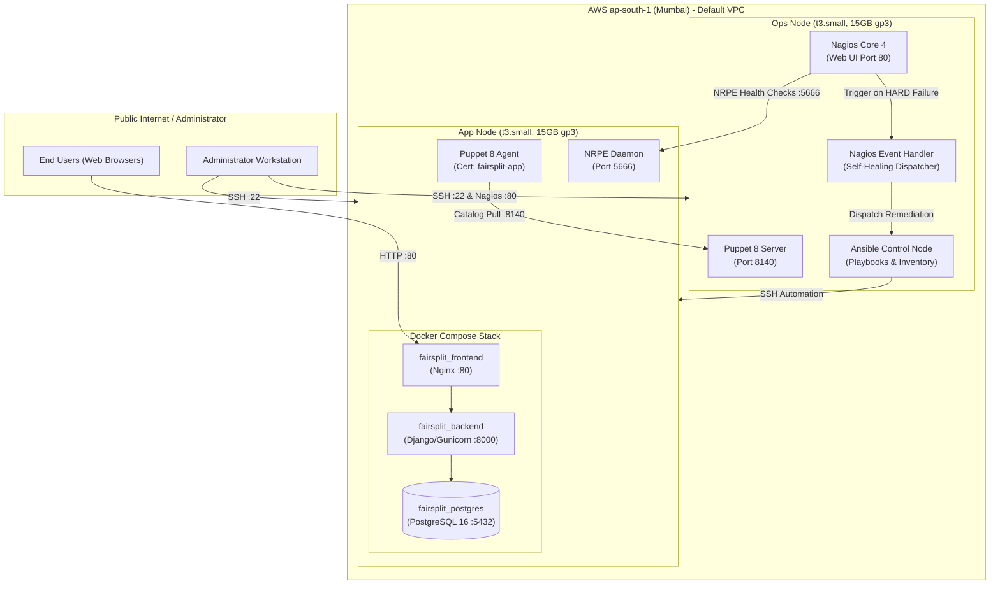
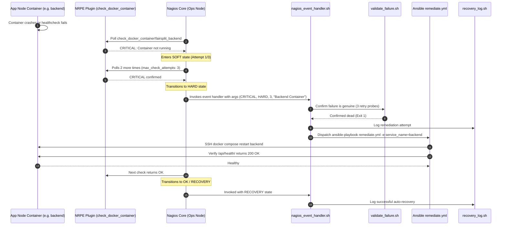

# FairSplit-Ops: System Architecture Specification

## 1. Overview & Core Philosophy

**FairSplit-Ops** is an enterprise-grade DevOps implementation for the FairSplit expense-sharing application. The infrastructure and automation are structured around strict separation of concerns across five discrete operational layers:

```
┌─────────────────────────────────────────────────────────────┐
│                 FairSplit-Ops Architecture                  │
├───────────────┬─────────────────────────────────────────────┤
│ Tool          │ Primary Responsibility                      │
├───────────────┼─────────────────────────────────────────────┤
│ Terraform     │ Infrastructure as Code (AWS VPC, EC2, SG)   │
│ Puppet        │ Configuration Management & Baseline State   │
│ Ansible       │ Application Deployment & Remediation Engine │
│ Nagios Core   │ Health Monitoring & Failure Detection       │
│ Docker / Cmp  │ Containerized Application Runtime           │
└───────────────┴─────────────────────────────────────────────┘
```

---

## 2. Infrastructure Topology

The system is deployed in AWS region **Mumbai (`ap-south-1`)** across a two-node topology inside the default VPC.



---

## 3. Security Boundary & Firewall Rules

Discrete security groups enforce least privilege with zero cross-contamination:

### Ops Security Group (`fairsplit-dev-ops-sg`)
| Direction | Port | Protocol | Source / Destination | Purpose |
| :--- | :--- | :--- | :--- | :--- |
| Ingress | `22` | TCP | `${admin_ip_cidr}` | Secure administrative SSH access |
| Ingress | `80` | TCP | `${admin_ip_cidr}` | Nagios Core monitoring web interface |
| Ingress | `8140`| TCP | `fairsplit-dev-app-sg` | Puppet agent catalog retrieval |
| Egress | All | All | `0.0.0.0/0` | Outbound package updates & orchestration |

### App Security Group (`fairsplit-dev-app-sg`)
| Direction | Port | Protocol | Source / Destination | Purpose |
| :--- | :--- | :--- | :--- | :--- |
| Ingress | `80` | TCP | `0.0.0.0/0` | Public end-user access to FairSplit |
| Ingress | `22` | TCP | `${admin_ip_cidr}` & Ops SG | Admin & Ansible SSH management |
| Ingress | `5666`| TCP | `fairsplit-dev-ops-sg` | NRPE health monitoring queries |
| Egress | All | All | `0.0.0.0/0` | Container image pulls & outbound traffic |

> **Security Note:** Ports `5432` (PostgreSQL) and `8000` (Django/Gunicorn) have **zero public ingress**. They are reachable exclusively inside the private Docker network (`fairsplit_net`) on the App Node.

---

## 4. Self-Healing & Automated Remediation Workflow

The self-healing pipeline ensures high availability without manual human intervention:



---

## 5. Component Responsibilities

### 1. Terraform (`terraform/`)
- Manages AWS compute (EC2), network data sources (VPC/Subnets), and security groups.
- Discovers existing default VPC (`vpc-012757c89854197cd`) without creating redundant VPCs or NAT gateways.
- Generates dynamic Ansible inventory template (`inventory/hosts.ini`).

### 2. Puppet (`puppet/`)
- Declarative node configuration via Hiera 5 hierarchy (`puppet/data/common.yaml`).
- Configures system swap (2GB swap file on Ops Node for JVM memory stability).
- Manages base packages, SSH hardening, chrony NTP, timezone, UFW rules, and Docker daemon runtime.
- Installs and configures Nagios Server and NRPE agent.

### 3. Ansible (`ansible/`)
- **`deploy.yml`**: Clones repository, sets up environment files, builds and starts Docker containers, runs database migrations, and verifies application health.
- **`remediate.yml`**: Restarts degraded containers, inspects container logs, and validates health restoration.
- **`backup.yml`**: Executes `pg_dump` via Docker, compresses SQL dumps with gzip, validates dump size, and rotates historical backups.
- **`restore.yml`**: Drops and recreates target PostgreSQL database from compressed backup file, restarts backend, and verifies database integrity.
- **`rollback.yml`**: Rolls back application to a previous Git commit or image tag gracefully.

### 4. Nagios Core (`nagios/`)
- Monitored services: Host ping, SSH, Disk utilization (`check_disk.sh`), Docker container health (`check_docker_container.sh`), and HTTP end-to-end API health (`check_fairsplit.sh`).
- Event handlers integrated directly with Ansible remediation scripts.

